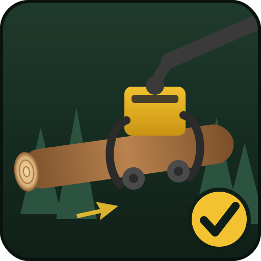

# Wood Harvester Controls – private Version (NikGro)
<i>Current version 0.3.0.0</i>

Private Weiterentwicklung von **Wood Harvester Controls** für Farming Simulator 25.

- Original: [BargonMods/FS25_WoodHarvesterControls](https://github.com/BargonMods/FS25_WoodHarvesterControls) (Bargon Mods)
- Basis dieser Version: der Fork [joevento/FS25_WoodHarvesterControls](https://github.com/joevento/FS25_WoodHarvesterControls) v0.2.3.0

> **Nur für den Eigengebrauch.** BargonMods erlaubt die Veröffentlichung des Mods ausschließlich selbst. Dieses Repo bitte privat halten und den Mod nicht weiterverbreiten.

## Änderungen in 0.3.0.0

### Fixes
- **Issue #2 – Hochkippen mit der Öffnen-Taste geht nicht immer / Greifer-Tasten reagieren nach Aus- und Einsteigen nicht mehr**
  - Ein Tasten-Loslassen kommt jetzt immer an, auch wenn der Kopf zwischendurch ausgeschaltet wurde. Vorher wurde es verworfen, und Haltezeiten bzw. erzwungenes Kippen blieben aktiv.
  - Beim Verlassen des Fahrzeugs oder wenn der Input wechselt, werden alle noch gehaltenen Tasten automatisch losgelassen.
  - „Erzwungenes Runterkippen“ konnte hängenbleiben, wenn währenddessen über die Öffnen-Taste hochgekippt wurde. Das Loslassen setzt es jetzt immer zurück.
  - Beim Ausschalten des Kopfes werden alle Halte-Timer zurückgesetzt.
- **Messer schließen beim Einziehen (Fix aus dem Fork, überarbeitet):** Der Fork hat den Schließbefehl in jedem Tick gesendet, inklusive Netzwerk-Events. Jetzt wird nur nachgeschlossen, wenn sich der Durchmesser ändert oder die Messer nicht in Position sind. Köpfe ohne `cutNode` werden nicht mehr dauerhaft zugehalten.
- **„Stämme unter X Durchmesser löschen“ (aus dem Fork):** standardmäßig **aus**. Wenn aktiv, betrifft es nur abgeschnittene, heruntergefallene Stücke, nie den Stamm im Kopf und nie einen Stubben.
- Doppelte Aktions-Registrierung (`DEFAULT_SAW` statt `DEFAULT_MENU`) aus dem Fork übernommen.
- Fehlerhafte Lua-Standardwerte bei der Aktions-Registrierung (`x and false or true`) korrigiert.

### Übernommen aus dem Fork (joevento)
- Längen-Presets 5 und 6 (Preset-Taste 3)
- Herunterkippen mit der Schließen-Taste. Hier **standardmäßig aus**, weil es das Verhalten der Schließen-Taste ändert. Einschaltbar im Menü unter „Kippen“.
- Höhere Maximalwerte für Durchmesser und Vorschub
- Option „Fällen außerhalb eigener Flächen erlauben“ (standardmäßig aus)

### Intern
- Eigenes Mod-Icon (`docs/icon.svg`, eigene Zeichnung).
- Einstellung `thisIsaVariable` heißt jetzt `tiltDownWithCloseButton`. Alte Spielstände des Forks werden weiter gelesen.

## Installation

1. Den Repo-Inhalt (`modDesc.xml`, `icon_whc.dds`, `src/`, `translations/`, `assets/`) als `FS25_WoodHarvesterControls.zip` packen. Die `modDesc.xml` muss direkt im ZIP liegen.
2. Die ZIP in den Mods-Ordner legen und dabei eine vorhandene Version ersetzen.
3. Im Spiel die Tastenbelegung prüfen: [Input Bindings & Dual Joystick Setup](https://youtu.be/OWci1IiBBPE?si=Gjt3ITx5fRLQXc56).

Der GitHub-Workflow `.github/workflows/release.yml` erzeugt die ZIP automatisch als Release, sobald sich die Versionsnummer oben in dieser README ändert.

## Multiplayer

Unterstützt. Im Multiplayer müssen alle Spieler dieselbe ZIP verwenden.
